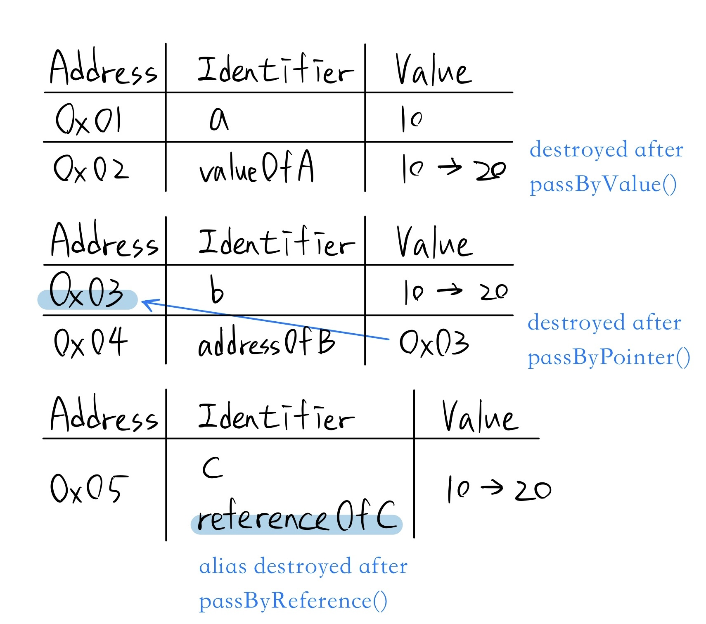

# Pass By Value, Pointer, Reference

```cpp
#include <iostream>

using namespace std;

void passByValue(int valueOfA)
{
    valueOfA += 10;
    cout << "In passByValue(), valueOfA = " << valueOfA << "\n";
}

void passByPointer(int* addressOfB)
{
    *addressOfB += 10; // dereference
    cout << "In passByPointer(), *addressOfB = " << *addressOfB << "\n";
}

void passByReference(int& referenceOfC)
{
    referenceOfC += 10;
    cout << "In passByReference(), referenceOfC = " << referenceOfC << "\n";
}

int main()
{
    int a = 10;
    cout << "Before passByValue(), a = " << a << "\n";
    passByValue(a);
    cout << "After passByValue(), a = " << a << "\n\n";

    int b = 10;
    cout << "Before passByPointer(), b = " << b << "\n";
    passByPointer(&b); // pass address of b
    cout << "After passByPointer(), b = " << b << "\n\n";

    int c = 10;
    cout << "Before passByReference(), c = " << c << "\n";
    passByReference(c);
    cout << "After passByReference(), c = " << c << "\n";

    return 0;
}
```

## Output

```
Before passByValue(), a = 10
In passByValue(), valueOfA = 20
After passByValue(), a = 10

Before passByPointer(), b = 10
In passByPointer(), *addressOfB = 20
After passByPointer(), b = 20

Before passByReference(), c = 10
In passByReference(), referenceOfC = 20
After passByReference(), c = 20
```

## Note



* Addresses are pseudo-address.

## Anki

Q:
void f(int a);

pass by pointer form?

A:
void f(int* a);

Q:
void f(int a);

pass by reference form?

A:
void f(int& a);

Q:
void f(int* ptr) {
    ...
}

int main()
{
    int a = 10;
    ...
}

如何在 main function 中使用函數 f，並傳遞 a 的 address？

A:
f(&a);
&: address-of operator 取址運算子

Q:
void f(int* a) {
    ...
}

如何在函數 f 中對指標 a 進行解參考（dereference），並將 a 所指向的值 += 10？

A:
*a += 10;
*: dereference operator 解參考運算子